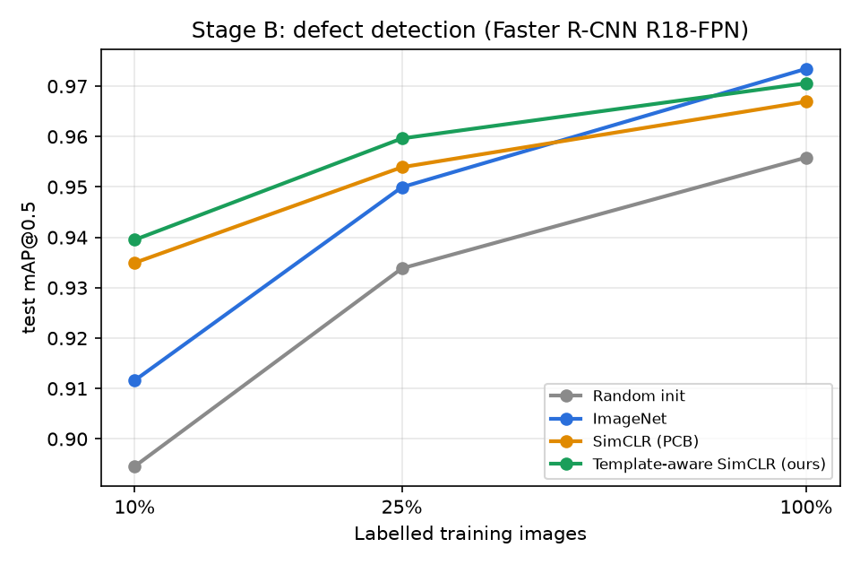

# Label-Efficient PCB Defect Detection via Template-Aware Self-Supervised Pretraining

Deep Learning Experiential Learning (EL) project, RV College of Engineering, Bengaluru.

| | |
|---|---|
| **Student** | USN 1RV23CS310 |
| **Guide** | Prof. Rajatha |
| **Department** | Computer Science and Engineering |
| **Course** | Deep Learning |
| **Dataset** | [DeepPCB](https://github.com/tangsanli5201/DeepPCB) (1,500 aligned PCB image pairs, 6 defect classes) |
| **Draft paper** | [reports/paper/Draft_Paper_Template_Aware_SSL_PCB.pdf](reports/paper/Draft_Paper_Template_Aware_SSL_PCB.pdf) |
| **Slides** | [reports/DL_EL_Presentation.pptx](reports/DL_EL_Presentation.pptx) |

## Problem

Labelling bounding boxes for PCB defects is slow and expensive, while automated optical inspection
(AOI) lines produce thousands of unlabelled board images every day. This project asks two questions:

1. Can self-supervised contrastive pretraining on unlabelled PCB patches let a defect detector reach
   high accuracy with only a fraction of the labelled images?
2. Can the defect-free **template** image, which every AOI line already has, make that pretraining better?

## Approach

* A ResNet-18 encoder is pretrained with **SimCLR** on 79,295 unlabelled 64x64 patches cut from the training boards.
* **Template-aware SimCLR (proposed):** a label-free difference map between the tested image and its
  aligned template decides, for each patch, how the template crop is used.
  * Where the two agree, the template crop is an extra **positive** view.
  * Where they differ, the template crop is a **hard negative**, because the only thing separating it
    from the anchor is the defect itself.
* The pretrained encoder is then transferred to
  * **Stage A:** a seven-class patch classifier (fine-tuned, and a frozen linear probe), and
  * **Stage B:** a Faster R-CNN detector with a ResNet-18 FPN backbone.
* Four initialisations are compared under an identical protocol at several label fractions:
  random, ImageNet, plain SimCLR and template-aware SimCLR.

## Key results

Test mAP@0.5 of the detector on the official DeepPCB test split (500 images):

| Initialisation | 10% labels | 25% labels | 100% labels |
|---|---|---|---|
| Random init | 0.895 | 0.934 | 0.956 |
| ImageNet | 0.912 | 0.950 | **0.973** |
| SimCLR (PCB) | 0.935 | 0.954 | 0.967 |
| Template-aware SimCLR (ours) | **0.939** | **0.960** | 0.971 |

* With only 25% of the labelled images, template-aware SimCLR already beats a randomly initialised
  detector trained on 100% of the labels.
* On the frozen linear probe, template-aware SimCLR is best at every label fraction
  (macro F1 0.818 vs 0.533 for ImageNet with 2% of the labels).
* A naive ablation that always uses the template as a positive makes the encoder blind to defects and hurts.
* Results hold on the 332 test boards from board designs never seen in training.



All tables and figures are in [reports/RESULTS.md](reports/RESULTS.md); it is regenerated from the run folders.

## Repository layout

```
src/pcbssl/          Python package: data pipeline, models, training engines, metrics, Grad-CAM
scripts/             prepare_data, pretrain, train_classifier, train_detector, run_experiments, make_report
app/demo.py          Gradio demo: board-level detection plus patch Grad-CAM
tests/test_core.py   unit tests for the sampler, box transforms, loss and metrics
runs/                metrics.json of every experiment (model weights are not committed, too large)
reports/             RESULTS.md, figures, slide deck and the draft paper
```

## How to run

Windows, Python 3.10+, NVIDIA GPU recommended (developed on an RTX 4070 Laptop, 8 GB).

```bash
python -m venv .venv
.venv\Scripts\activate
pip install torch torchvision --index-url https://download.pytorch.org/whl/cu128
pip install -r requirements.txt
pip install -e .
```

```bash
python scripts/prepare_data.py --download   # clones DeepPCB (~220 MB) and builds the patch caches
python scripts/run_experiments.py           # full grid; resumable, add --quick for a 5-minute smoke run
python scripts/make_report.py               # tables, figures and reports/RESULTS.md
python app/demo.py                          # interactive demo
python -m pytest -q                         # unit tests
```

## Experimental protocol in brief

* Official DeepPCB test split; 100 validation images (stratified by board group) used only for model selection.
* Label fractions are taken per image, nested and stratified by board group. Stage A: 2, 10, 25, 100% with 3 seeds. Stage B: 10, 25, 100%.
* Pretraining: ResNet-18, 60 epochs, batch 512, AdamW 1e-3, cosine schedule, temperature 0.2.
* Stage B: Faster R-CNN R18-FPN, small anchors (16 to 256 px), 2,500 iterations, batch 8, SGD 0.01.
* Only the starting weights change between arms; architecture, augmentation, schedule and seeds are identical.

## References

1. S. Tang, F. He, X. Huang, J. Yang, "Online PCB Defect Detector On A New PCB Defect Dataset", arXiv:1902.06197, 2019.
2. T. Chen, S. Kornblith, M. Norouzi, G. Hinton, "A Simple Framework for Contrastive Learning of Visual Representations", ICML 2020.
3. S. Ren, K. He, R. Girshick, J. Sun, "Faster R-CNN: Towards Real-Time Object Detection with Region Proposal Networks", NeurIPS 2015.
4. J. Robinson, C.-Y. Chuang, S. Sra, S. Jegelka, "Contrastive Learning with Hard Negative Samples", ICLR 2021.

DeepPCB is released by its authors for research use only.
