# Results

Generated by `scripts/make_report.py` from the run folders. Values are on the official DeepPCB test split (500 images). Where several seeds exist, cells show the mean and, in brackets, the min to max range across seeds.

## Data

* Images: 900 train, 100 validation, 500 test. 332 test images come from board designs never seen in training.
* Unlabelled pretraining patches: 79,295 (73,098 grid, 6,197 difference-guided).
* Label-free difference map recall of annotated defects: 99.7% (loose), 80.2% (strict).

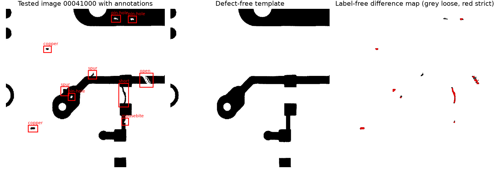

## Pretraining

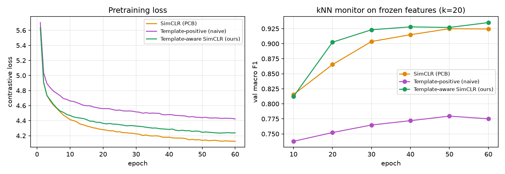

| Encoder | final loss | kNN val macro F1 |
|---|---|---|
| SimCLR (PCB) | 4.126 | 0.924 |
| Template-positive (naive) | 4.423 | 0.775 |
| Template-aware SimCLR (ours) | 4.238 | 0.935 |

## Stage A: patch classification (fine-tuned)

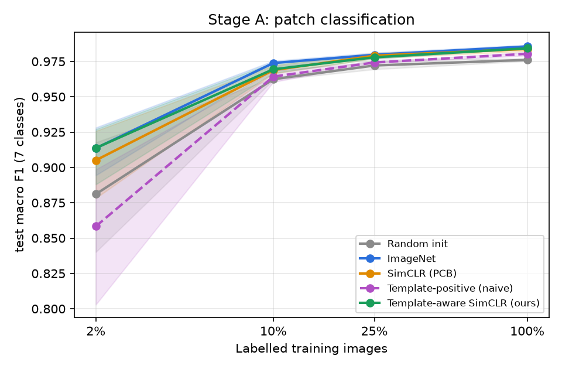

Test macro F1:

| Initialisation | 2% labels | 10% labels | 25% labels | 100% labels |
|---|---|---|---|---|
| Random init | 0.881 (0.840 to 0.918) | 0.962 (0.962 to 0.963) | 0.972 (0.969 to 0.976) | 0.976 (0.975 to 0.977) |
| ImageNet | 0.914 (0.894 to 0.928) | 0.974 (0.971 to 0.975) | 0.980 (0.977 to 0.981) | 0.986 (0.984 to 0.987) |
| SimCLR (PCB) | 0.905 (0.878 to 0.926) | 0.969 (0.966 to 0.972) | 0.979 (0.977 to 0.981) | 0.984 (0.982 to 0.985) |
| Template-positive (naive) | 0.858 (0.803 to 0.899) | 0.964 (0.960 to 0.968) | 0.974 (0.974 to 0.975) | 0.980 (0.979 to 0.982) |
| Template-aware SimCLR (ours) | 0.914 (0.888 to 0.927) | 0.969 (0.967 to 0.974) | 0.978 (0.977 to 0.979) | 0.984 (0.984 to 0.985) |

Test macro F1 over the six defect classes only:

| Initialisation | 2% labels | 10% labels | 25% labels | 100% labels |
|---|---|---|---|---|
| Random init | 0.866 (0.821 to 0.907) | 0.958 (0.957 to 0.959) | 0.969 (0.966 to 0.974) | 0.973 (0.972 to 0.975) |
| ImageNet | 0.902 (0.881 to 0.918) | 0.971 (0.968 to 0.972) | 0.977 (0.974 to 0.979) | 0.984 (0.982 to 0.985) |
| SimCLR (PCB) | 0.892 (0.862 to 0.916) | 0.965 (0.962 to 0.968) | 0.976 (0.974 to 0.978) | 0.982 (0.980 to 0.983) |
| Template-positive (naive) | 0.839 (0.777 to 0.884) | 0.960 (0.955 to 0.964) | 0.971 (0.970 to 0.971) | 0.978 (0.976 to 0.979) |
| Template-aware SimCLR (ours) | 0.902 (0.874 to 0.917) | 0.966 (0.962 to 0.971) | 0.975 (0.974 to 0.976) | 0.982 (0.982 to 0.983) |

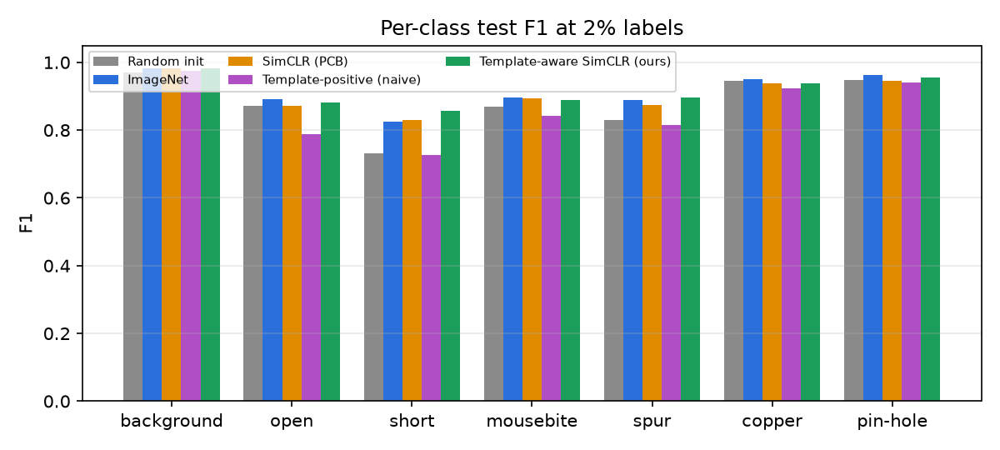

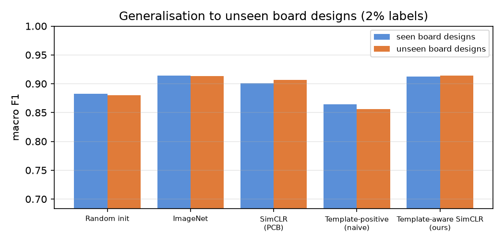

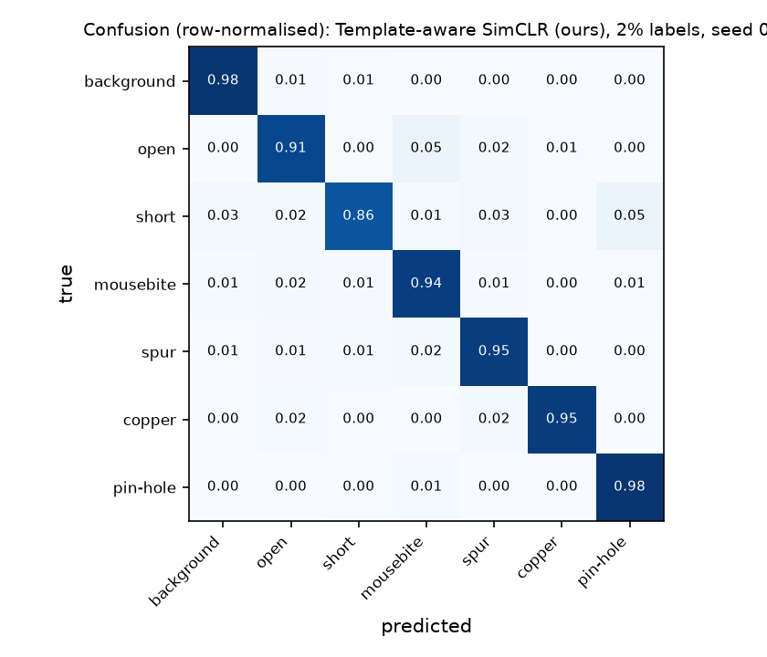

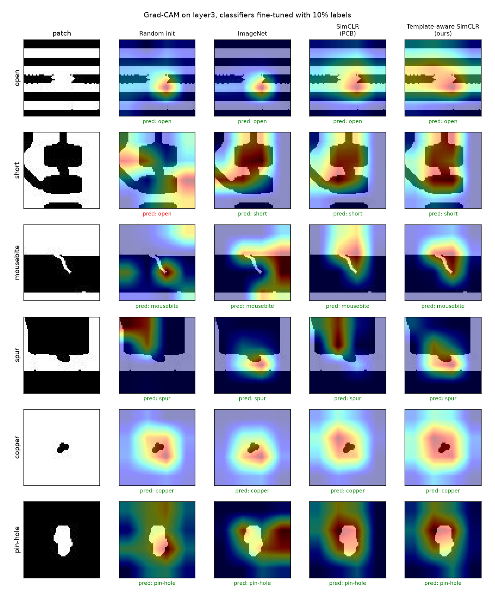

## Linear probe (frozen encoder)

Measures representation quality directly: only a linear layer is trained.

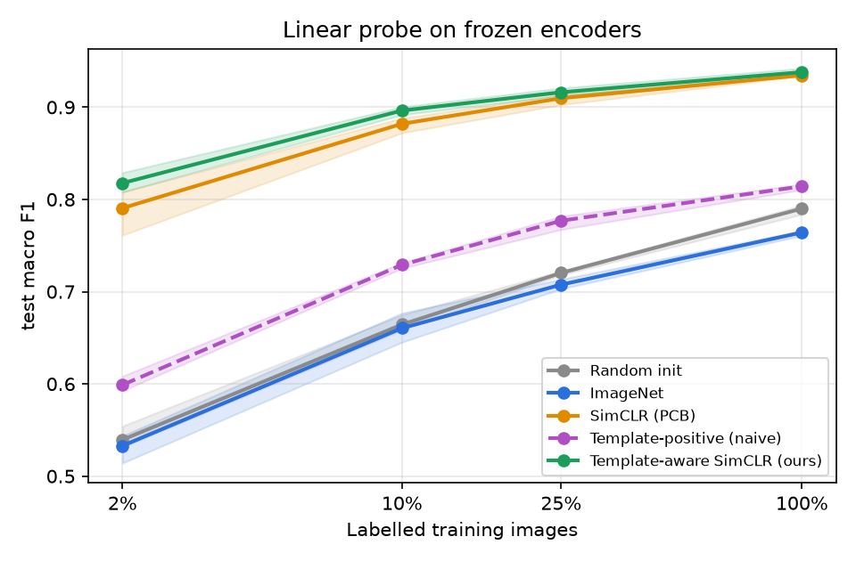

| Initialisation | 2% labels | 10% labels | 25% labels | 100% labels |
|---|---|---|---|---|
| Random init | 0.539 (0.531 to 0.554) | 0.664 (0.658 to 0.675) | 0.720 (0.718 to 0.722) | 0.790 (0.784 to 0.794) |
| ImageNet | 0.533 (0.514 to 0.544) | 0.660 (0.645 to 0.677) | 0.708 (0.703 to 0.714) | 0.764 (0.761 to 0.766) |
| SimCLR (PCB) | 0.791 (0.761 to 0.808) | 0.882 (0.872 to 0.888) | 0.910 (0.903 to 0.913) | 0.935 (0.934 to 0.935) |
| Template-positive (naive) | 0.599 (0.592 to 0.608) | 0.729 (0.725 to 0.731) | 0.777 (0.767 to 0.782) | 0.814 (0.810 to 0.817) |
| Template-aware SimCLR (ours) | 0.818 (0.808 to 0.829) | 0.896 (0.892 to 0.900) | 0.916 (0.912 to 0.921) | 0.938 (0.934 to 0.942) |

## Stage B: detection (headline result)

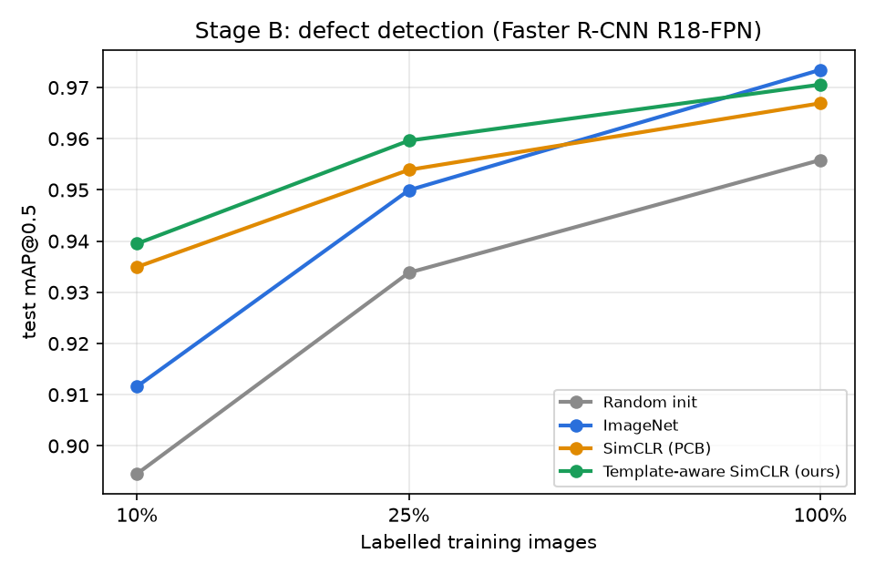

Test mAP@0.5:

| Initialisation | 10% labels | 25% labels | 100% labels |
|---|---|---|---|
| Random init | 0.895 | 0.934 | 0.956 |
| ImageNet | 0.912 | 0.950 | 0.973 |
| SimCLR (PCB) | 0.935 | 0.954 | 0.967 |
| Template-aware SimCLR (ours) | 0.939 | 0.960 | 0.971 |

Test mAP@0.5:0.95 (COCO-style):

| Initialisation | 10% labels | 25% labels | 100% labels |
|---|---|---|---|
| Random init | 0.608 | 0.660 | 0.702 |
| ImageNet | 0.641 | 0.675 | 0.744 |
| SimCLR (PCB) | 0.664 | 0.703 | 0.730 |
| Template-aware SimCLR (ours) | 0.640 | 0.705 | 0.732 |

DeepPCB benchmark protocol, F-score at IoU 0.33 at the best threshold:

| Initialisation | 10% labels | 25% labels | 100% labels |
|---|---|---|---|
| Random init | 0.867 | 0.910 | 0.918 |
| ImageNet | 0.895 | 0.923 | 0.942 |
| SimCLR (PCB) | 0.894 | 0.919 | 0.934 |
| Template-aware SimCLR (ours) | 0.898 | 0.930 | 0.940 |

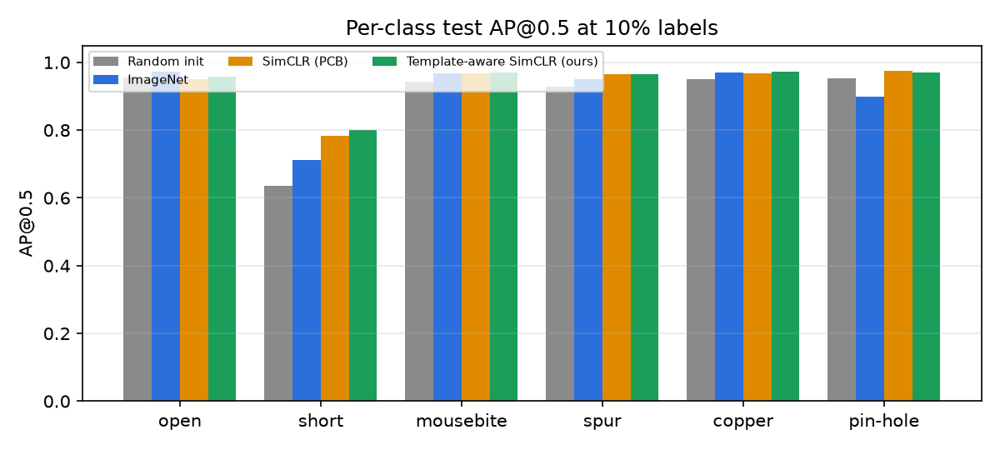

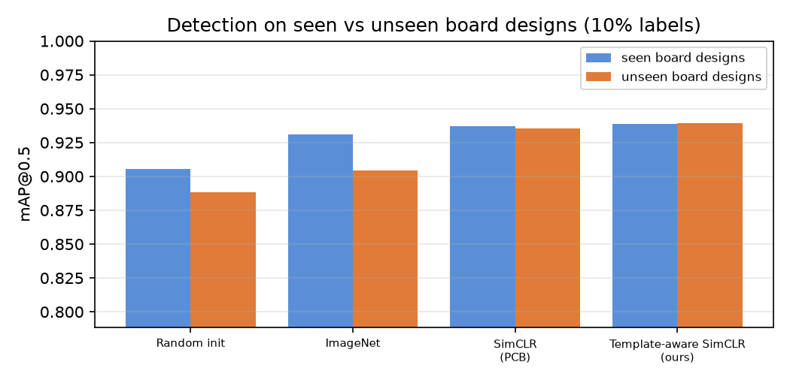

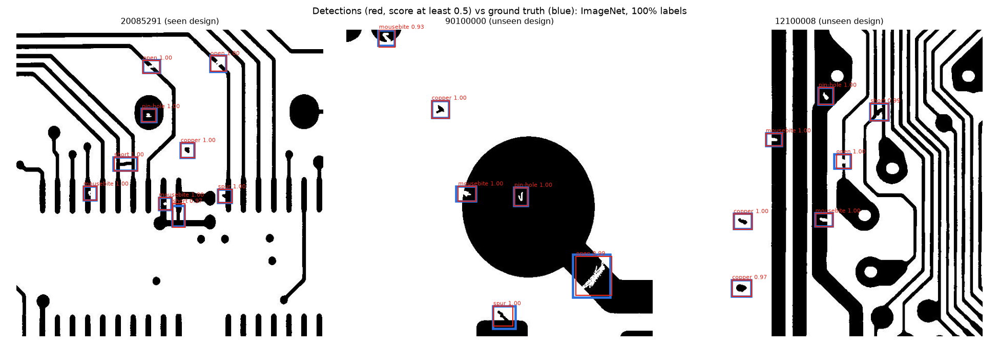

## Embeddings

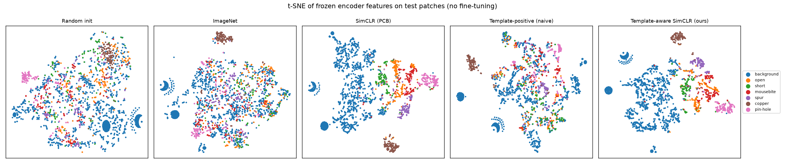
