# Results

Generated by `scripts/make_report.py` from the run folders. Values are on the official DeepPCB test split (500 images). Where several seeds exist, cells show the mean and, in brackets, the min to max range across seeds.

## Data

* Images: 900 train, 100 validation, 500 test. 332 test images come from board designs never seen in training.
* Unlabelled pretraining patches: 79,295 (73,098 grid, 6,197 difference-guided).
* Label-free difference map recall of annotated defects: 99.7% (loose), 80.2% (strict).

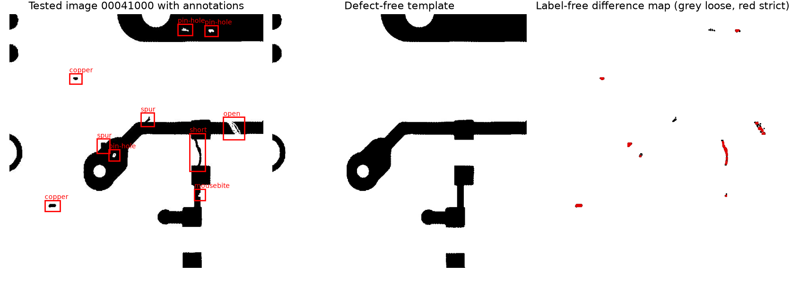

## Pretraining

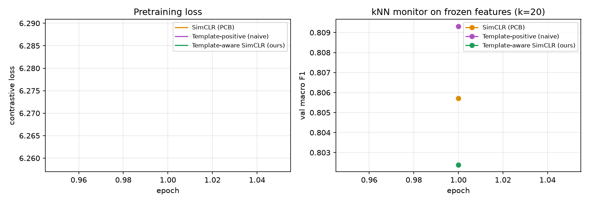

| Encoder | final loss | kNN val macro F1 |
|---|---|---|
| SimCLR (PCB) | 6.259 | 0.806 |
| Template-positive (naive) | 6.289 | 0.809 |
| Template-aware SimCLR (ours) | 6.259 | 0.802 |

## Stage A: patch classification (fine-tuned)

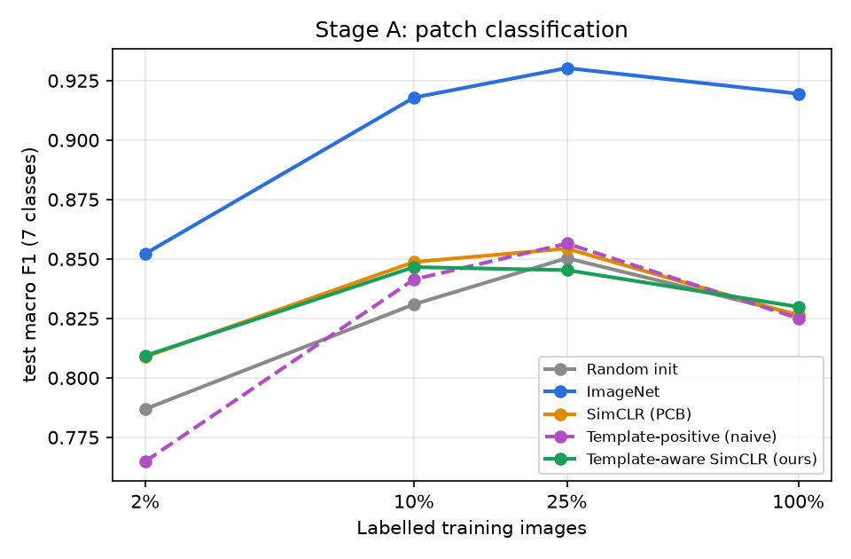

Test macro F1:

| Initialisation | 2% labels | 10% labels | 25% labels | 100% labels |
|---|---|---|---|---|
| Random init | 0.787 | 0.831 | 0.850 | 0.827 |
| ImageNet | 0.852 | 0.918 | 0.930 | 0.919 |
| SimCLR (PCB) | 0.809 | 0.849 | 0.854 | 0.826 |
| Template-positive (naive) | 0.765 | 0.841 | 0.856 | 0.825 |
| Template-aware SimCLR (ours) | 0.809 | 0.847 | 0.845 | 0.830 |

Test macro F1 over the six defect classes only:

| Initialisation | 2% labels | 10% labels | 25% labels | 100% labels |
|---|---|---|---|---|
| Random init | 0.761 | 0.813 | 0.834 | 0.806 |
| ImageNet | 0.830 | 0.907 | 0.921 | 0.909 |
| SimCLR (PCB) | 0.785 | 0.833 | 0.838 | 0.806 |
| Template-positive (naive) | 0.733 | 0.824 | 0.840 | 0.803 |
| Template-aware SimCLR (ours) | 0.786 | 0.830 | 0.827 | 0.810 |

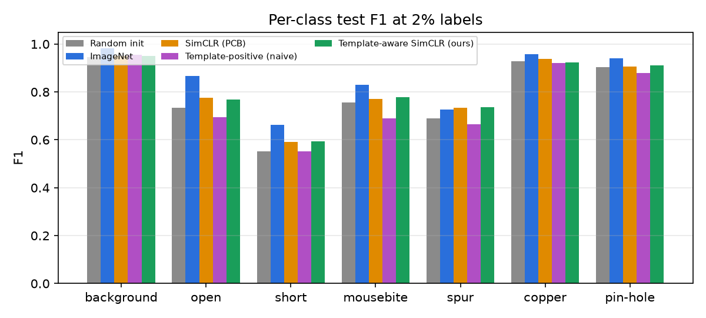

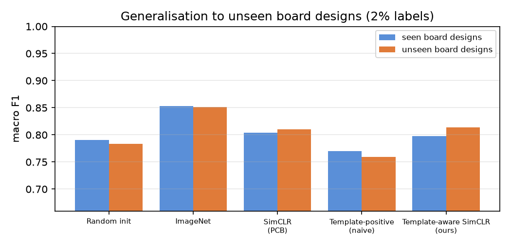

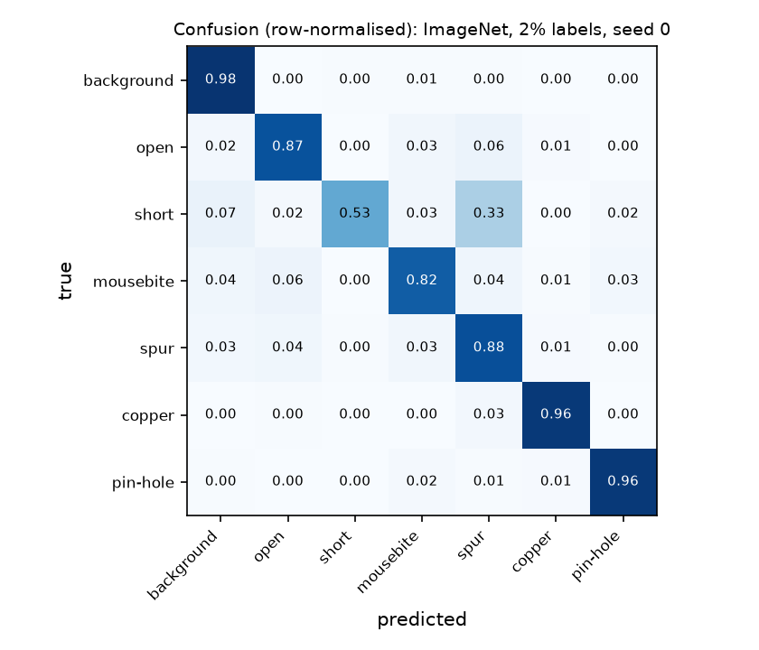

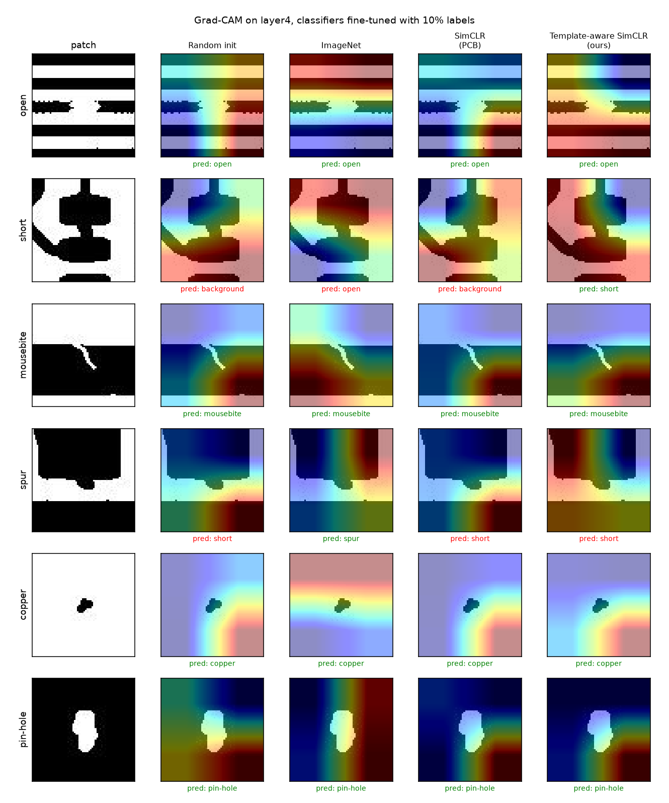

## Linear probe (frozen encoder)

Measures representation quality directly: only a linear layer is trained.

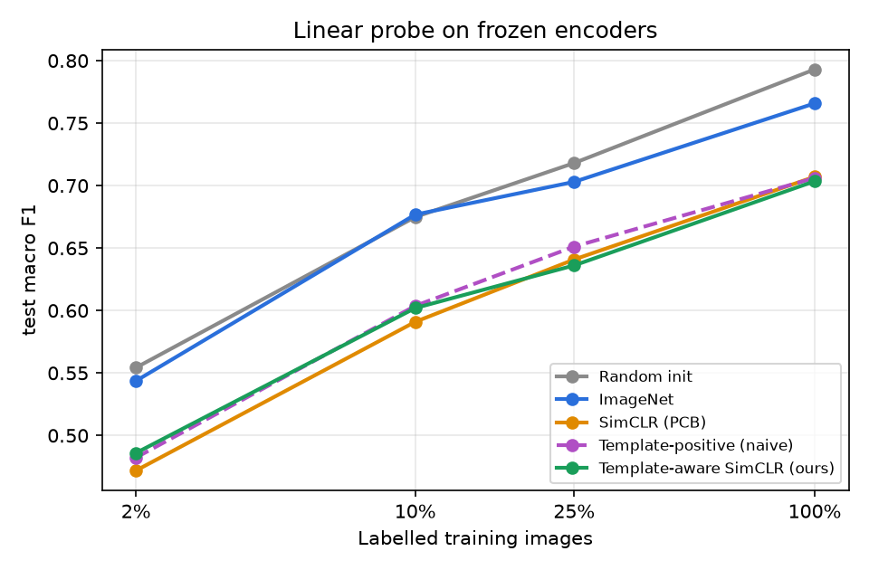

| Initialisation | 2% labels | 10% labels | 25% labels | 100% labels |
|---|---|---|---|---|
| Random init | 0.554 | 0.675 | 0.718 | 0.793 |
| ImageNet | 0.544 | 0.677 | 0.703 | 0.766 |
| SimCLR (PCB) | 0.472 | 0.591 | 0.641 | 0.707 |
| Template-positive (naive) | 0.482 | 0.604 | 0.651 | 0.706 |
| Template-aware SimCLR (ours) | 0.486 | 0.602 | 0.636 | 0.703 |

## Stage B: detection (headline result)

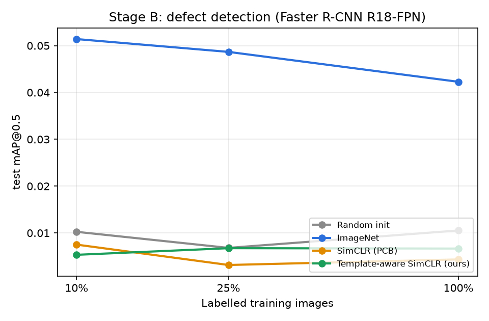

Test mAP@0.5:

| Initialisation | 10% labels | 25% labels | 100% labels |
|---|---|---|---|
| Random init | 0.010 | 0.007 | 0.011 |
| ImageNet | 0.051 | 0.049 | 0.042 |
| SimCLR (PCB) | 0.008 | 0.003 | 0.004 |
| Template-aware SimCLR (ours) | 0.005 | 0.007 | 0.007 |

Test mAP@0.5:0.95 (COCO-style):

| Initialisation | 10% labels | 25% labels | 100% labels |
|---|---|---|---|
| Random init | 0.003 | 0.002 | 0.003 |
| ImageNet | 0.015 | 0.016 | 0.015 |
| SimCLR (PCB) | 0.002 | 0.001 | 0.001 |
| Template-aware SimCLR (ours) | 0.001 | 0.002 | 0.002 |

DeepPCB benchmark protocol, F-score at IoU 0.33 at the best threshold:

| Initialisation | 10% labels | 25% labels | 100% labels |
|---|---|---|---|
| Random init | 0.033 | 0.039 | 0.049 |
| ImageNet | 0.092 | 0.091 | 0.088 |
| SimCLR (PCB) | 0.038 | 0.028 | 0.033 |
| Template-aware SimCLR (ours) | 0.031 | 0.037 | 0.042 |

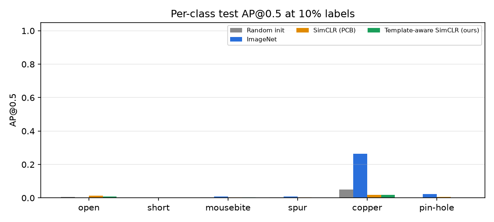

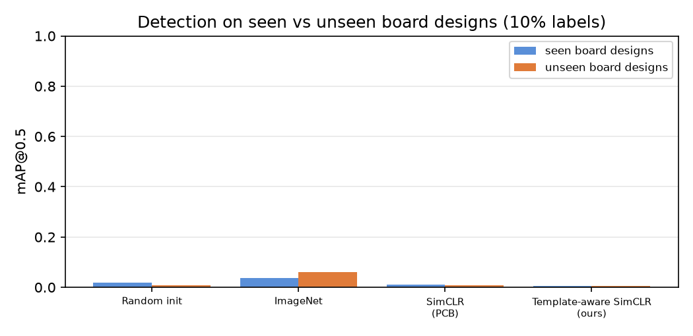

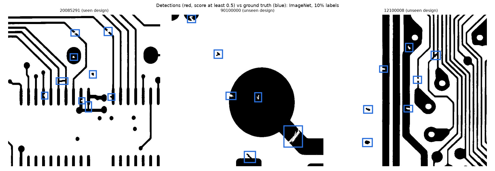

## Embeddings

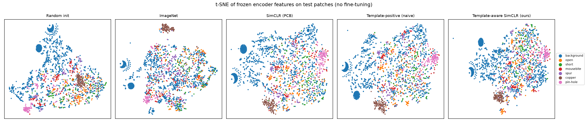
